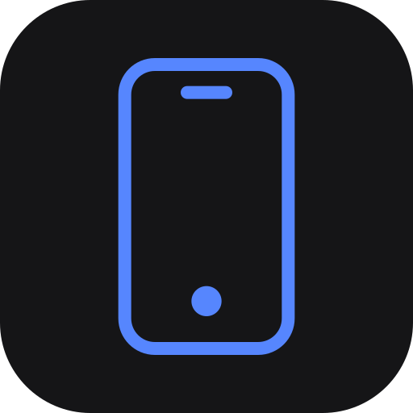
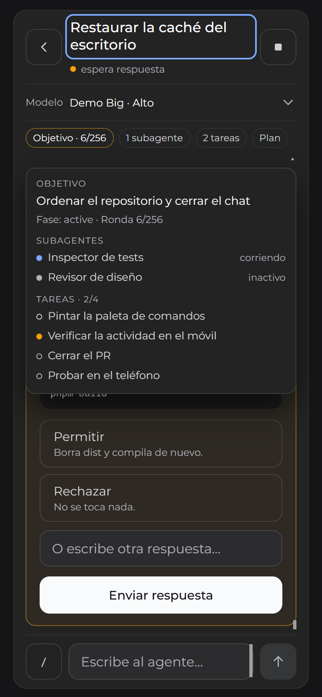
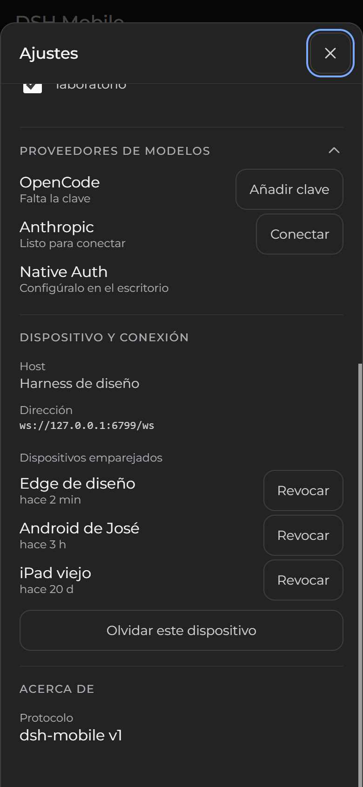
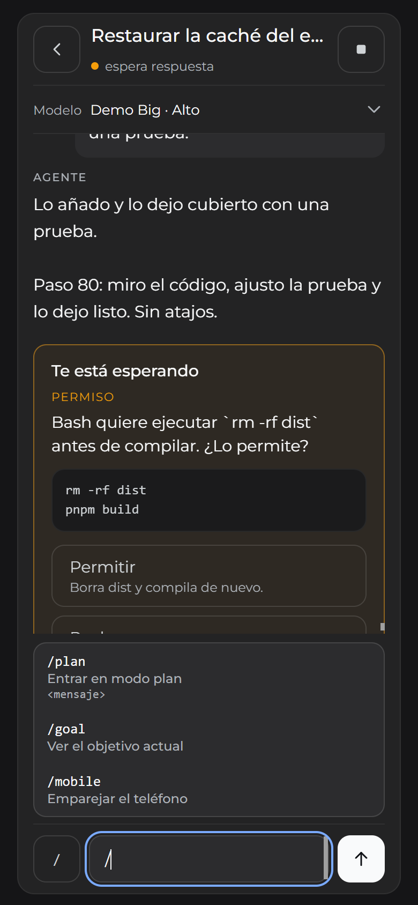
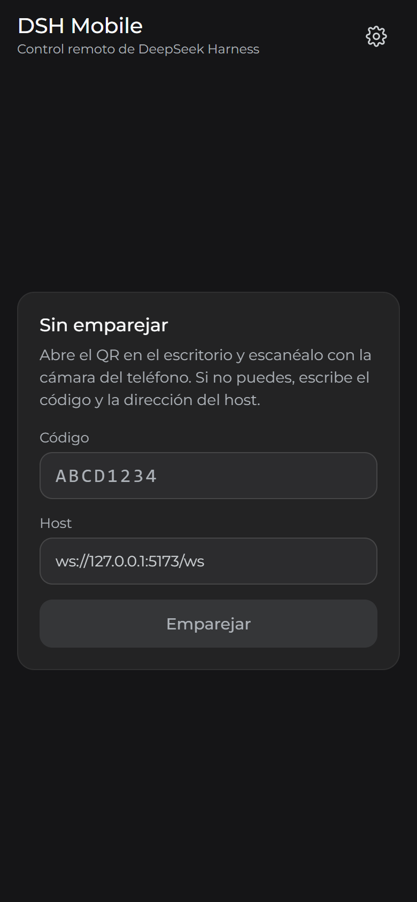
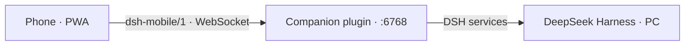

<div align="center">
  

  <h1>DSH Mobile</h1>

  <p><strong>Your DeepSeek Harness sessions, in your pocket.</strong><br />
  An installable PWA plus a host plugin. Pair once by QR, then read the transcript, answer and
  approve questions, run slash commands and manage the host from your phone — over your tailnet,
  with no cloud in between.</p>

  <p>
    <a href="https://github.com/joseph12n/dsh-mobile/actions/workflows/ci.yml"></a>
    <a href="https://sonarcloud.io/summary/new_code?id=joseph12n_dsh-mobile"></a>
    <a href="https://www.npmjs.com/package/@deepseekharness-mobile/companion"></a>
    <a href="https://www.npmjs.com/package/@deepseekharness-mobile/companion"></a>
    <a href="LICENSE"></a>
    <a href="package.json"></a>
    <a href="https://github.com/joseph12n/dsh-mobile"></a>
  </p>
  <p>
    <a href="https://github.com/deepseek-ai/deepseek-harness"></a>
    <a href="docs/phone-setup.md"></a>
    <a href="packages/app/src/i18n/locales.ts"></a>
    <a href="packages/app/package.json"></a>
    <a href="packages/app/package.json"></a>
  </p>

  <p>
    
    
    
    
  </p>

  <p><sub>A live turn with the agent activity panel · model providers and paired devices · slash commands · pairing</sub></p>
</div>

> **Status: working.** Pairing, live transcript, questions and approvals, slash commands, the
> activity panel, model providers and paired devices are shipped. The plugin is published on npm
> as `@deepseekharness-mobile/companion`; push notifications are the next phase
> ([#9](https://github.com/joseph12n/dsh-mobile/issues/9)).

## Why

The PC does the work. The phone is a remote control: it sees the sessions, reads the transcript,
answers and approves, and asks the host to act. It never runs a second agent, and no transcript
goes through a third-party server.

- **Contract first.** The phone talks `dsh-mobile/1`, a versioned Zod contract. Only the plugin
  knows DSH; if upstream changes, one adapter changes and the PWA does not notice.
- **One artifact.** The plugin serves the built PWA, so host and client are the same version by
  construction. Installing `@deepseekharness-mobile/companion` brings both.
- **The host decides.** Capabilities are negotiated in `hello.ok`; the client never hides with
  CSS what the server would not send.

## What you can do from the phone

- **Sessions and folders** — live state, waiting questions and the folder each session belongs
  to. Folders carry their own icon and colour, keep their heading while the list scrolls, and
  collapse.
- **Live transcript** — paged history and live events, with the reasoning separated from the
  answer.
- **Model and effort** — switch from the top of the conversation without scrolling back.
- **Questions and approvals** — the full text and options, including the agent's blocking
  `ask_user_question`, answered in an inline card.
- **Agent activity** — a compact strip with the goal and its round, the running subagents and
  the open tasks; one tap floats the details over the conversation without shrinking it.
- **Slash commands** — `/plan`, `/goal`, `/mobile` and the commands your plugins register. The
  result appears above the composer and never enters the model transcript.
- **Model providers** — list the host catalog, test a key and connect it. The key is stored on
  the host and never comes back; custom endpoints, headers, model overrides and OAuth stay on
  the desktop.
- **Paired devices** — see when each was last seen, revoke one, and forget this phone (which
  revokes it on the host first).
- **Compose and cancel** — send a message to the agent or stop the running turn.
- **Install and settings** — installable PWA, four locales, contrast setting, reduced-motion
  support and 44 px targets; the back gesture closes a sheet before it leaves the app.

## Quick start

### The published plugin

```sh
dsh profile add @deepseekharness-mobile/companion
```

Restart DSH, run `/mobile` in a session, open the link on the phone and install the PWA from the
browser menu. The full path — Tailscale, the tailnet URL and the usual problems — is in
[docs/phone-setup.md](docs/phone-setup.md).

### From the repo

```sh
pnpm install
pnpm build        # protocol first: the other two import its types
pnpm test         # vitest
pnpm smoke        # starts the built server and checks the PWA and pairing
pnpm typecheck
pnpm lint
pnpm dev          # PWA on http://127.0.0.1:5173
```

Link the plugin from your DSH profile (`~/.dsh/profiles/<profile>/package.json`):

```json
{
  "dsh": { "profile": { "bundles": ["@deepseekharness-mobile/companion"] } },
  "dependencies": {
    "@deepseekharness-mobile/companion": "link:/path/to/dsh-mobile/packages/companion"
  }
}
```

`pnpm smoke` checks **the package we publish**: it starts the `dist/` server serving the `dist/`
PWA on an ephemeral port and walks through pairing and listing sessions.

### Requirements

- **Node.js 24** — the plugin runs on the Node DSH embeds; development uses the same version.
- **pnpm 12**.
- DeepSeek Harness installed on the PC.
- **Tailscale** for the phone path: the listener is loopback-only and is reached through the
  tailnet name.

## How it works



The plugin runs **inside** the DSH process, so it sees the sessions without forking the core and
without breaking on upstream updates.

**The boundary is the contract.** The phone never talks to DSH's internals: it talks
`dsh-mobile/1`, a protocol of our own, versioned. If upstream changes, one adapter changes and
the client never notices.

**A single artifact.** The plugin serves the built PWA, so host and client cannot drift apart:
they are the same version by construction, and the npm package carries both.

| Package                                                   | What it is                                                 |
| --------------------------------------------------------- | ---------------------------------------------------------- |
| [`@deepseekharness-mobile/protocol`](packages/protocol)   | The contract: Zod schemas, types and constants. Isomorphic |
| [`@deepseekharness-mobile/companion`](packages/companion) | Host plugin: listener, pairing, PWA and the DSH adapter    |
| [`@deepseekharness-mobile/app`](packages/app)             | PWA: React + Vite, embedded in the companion               |

The contract requires **TypeScript** everywhere: one schema, two consumers, and an incompatible
change breaks the build instead of the user.

## Pairing

The desktop shows a **QR** that is not a bare code but a **direct link**:

```
https://<host>/#/pair?v=1&c=<code>
```

One scan answers _who_ you are; the connection goes to the host serving that page. The code
travels in the URL fragment, so it never reaches the server or a log. It expires in 10 minutes,
works once, and redeeming it creates a **device token** stored as a hash.

The token belongs to the device, not the network, so **the protocol does not tie a connection to
one address**. That said, honestly: **the app does not offer changing the endpoint yet**; today,
pointing at another address means pairing again.

And the only path that reaches the plugin is the **tailnet name**, because it listens on
loopback only. Direct LAN access is not implemented.

## Using the plugin

The plugin listens on `127.0.0.1:6768` and exposes:

| Route         | What it does                                       |
| ------------- | -------------------------------------------------- |
| `GET /`       | The installable PWA                                |
| `GET /pair`   | Pairing QR and the code as text                    |
| `GET /health` | State, protocol version, capabilities and devices  |
| `GET /probe`  | The same diagnostic report `/mobile estado` prints |
| `WS /ws`      | The `dsh-mobile/1` contract                        |

### The `/mobile` command

Inside DSH, `/mobile` prints **the pairing link, the code and when it expires**, so you do not
have to hand-build a URL or dig the code out of the console. `/mobile estado` prints the
diagnostic probe: which services are mounted, what the projections expose, and which ones can
take text.

The link comes out with the tailnet name when Tailscale is installed, so it can be opened
straight from the phone. When it cannot — no Tailscale, or a loopback origin — the message says
so instead of handing you a link that goes nowhere.

Environment variables: `DSH_MOBILE_PORT`, `DSH_MOBILE_PUBLIC_URL`, `DSH_MOBILE_WEB_ROOT`.
`DSH_HOME` decides where the plugin keeps its `companion/` folder and its evidence file.
`DSH_MOBILE_LOG_FILE=0` turns off the plugin's evidence file, which the tests and the preview
tool use so they do not dirty your log.

## Security

- **Loopback only.** The listen address is a constant in the code, not an option: the plugin
  serves `127.0.0.1` and is published through the tailnet name with `tailscale serve`. **It
  accepts no direct connections from the LAN** because it never opens that socket.
- **Never to the internet without solid authentication.** This is a client that can run actions
  on your machine. Today the tailnet's private network is the only supported path; exposing it
  to the internet is not.
- **One token per device, stored as a hash.** Revoking one does not affect the others.
- **The host decides.** The client does not hide with CSS what it cannot do: the server does not
  send it.
- **Narrow scope.** The phone cannot change arbitrary settings, plugins or model endpoints. The
  provider flow is key-only: the phone names a catalog provider and sends a key; the host
  derives the credential reference, stores it and never returns it. Custom endpoints, headers,
  model overrides and OAuth stay on the desktop.

To use it away from home, **Tailscale** is the recommendation: serve the PWA over HTTPS on the
tailnet name — a secure context, its own certificate, and one URL for home and for the street.

## Accessibility

The app targets WCAG 2.2 AA:

- **Focus and keyboard.** Opening a conversation moves focus to its title; coming back moves it
  to the session list heading, and both show a visible ring. The transcript is a polite live log
  with its own name, and every control has an accessible name.
- **Touch targets.** Interactive controls are at least 44×44 CSS pixels, including the icon-only
  buttons and the action at the end of each session row.
- **Motion.** What moves is transition-based. Under `prefers-reduced-motion` the movement is
  dropped while an opacity change keeps the state change legible; press feedback does not scale
  either.
- **Contrast.** Text is measured against the background it actually renders on; nothing falls
  below 4.5:1.
- **Language.** The document language follows the interface, and the four locales are complete.

The audit covers the session list (with folders), a conversation, the pairing screen, the
settings sheet and a pending question card: **0 violations** across the WCAG 2.0, 2.1 and 2.2 A
and AA rules, plus the best-practice rules on the question and conversation screens. The audit is
a local CDP harness; it is not part of CI because it needs a browser.

## Documentation

- [`docs/phone-setup.md`](docs/phone-setup.md) — **how to use it from the phone**, step by step,
  with Tailscale and the usual problems.
- [`docs/architecture.md`](docs/architecture.md) — **why** it is built this way: layers,
  protocol, pairing, and the decisions we rejected.
- [`docs/publishing.md`](docs/publishing.md) — how the packages are published.
- [`CONTRIBUTING.md`](CONTRIBUTING.md) — how to work on the repo.
- [`packages/protocol/src/messages.ts`](packages/protocol/src/messages.ts) — the contract, as code
  and as the source of truth.

## License

[MIT](LICENSE).
