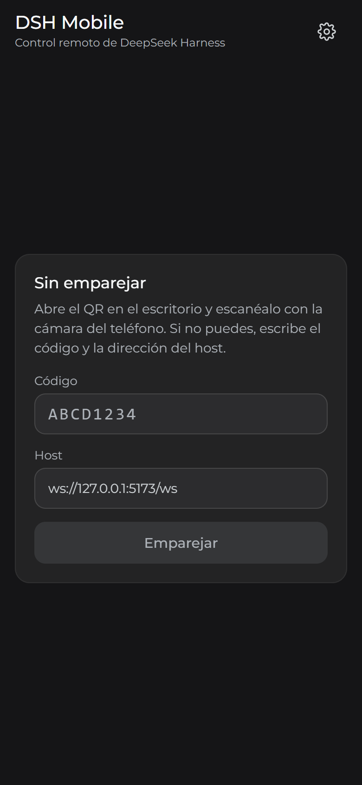
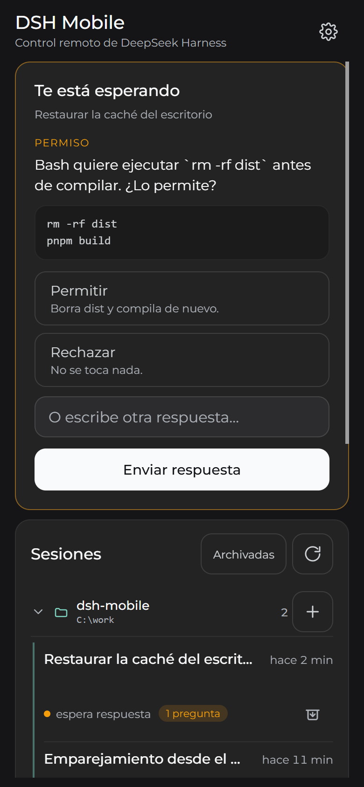
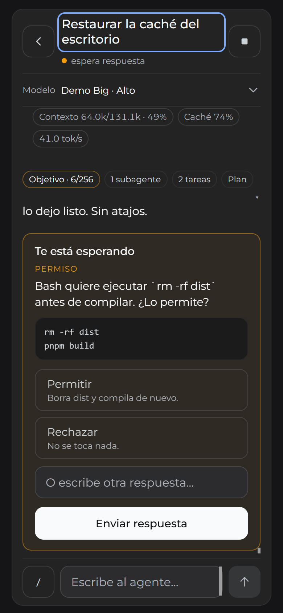
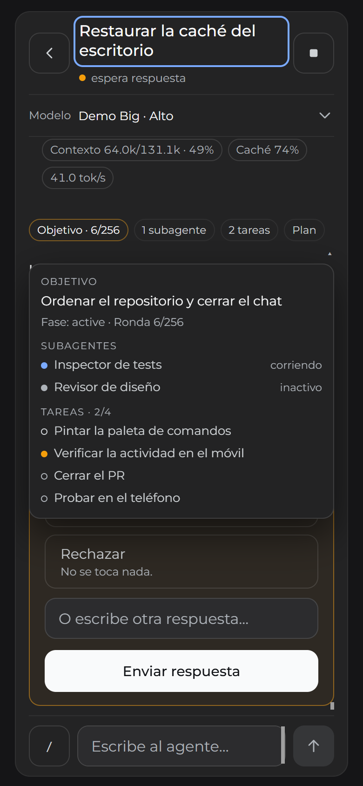
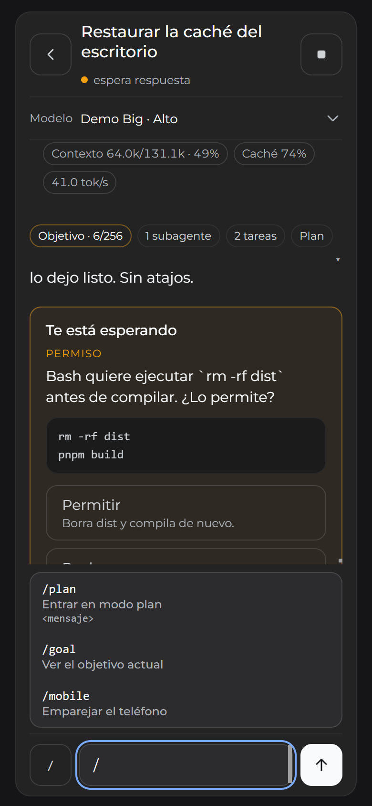
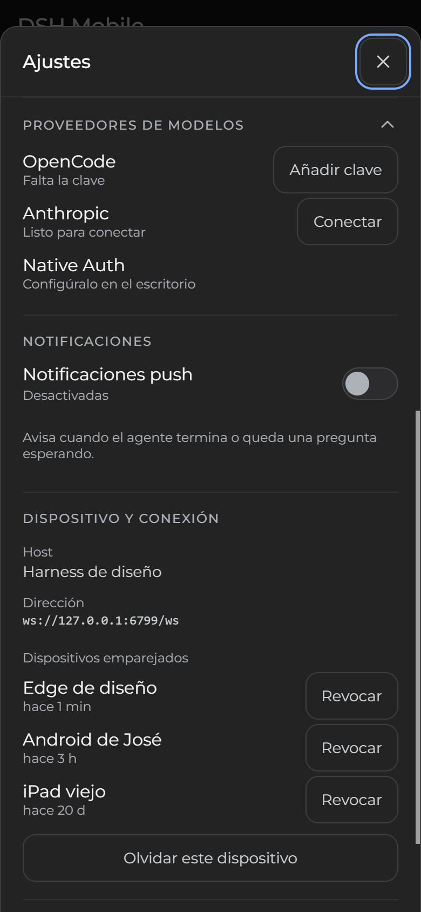
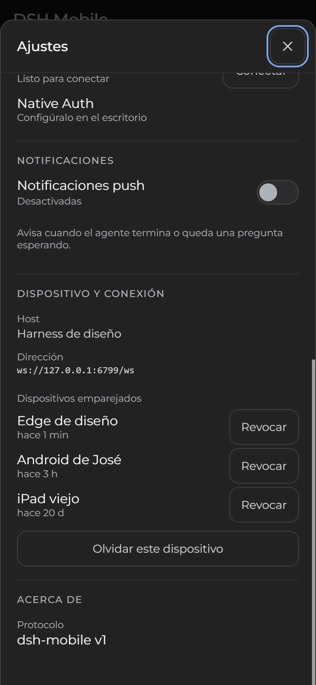
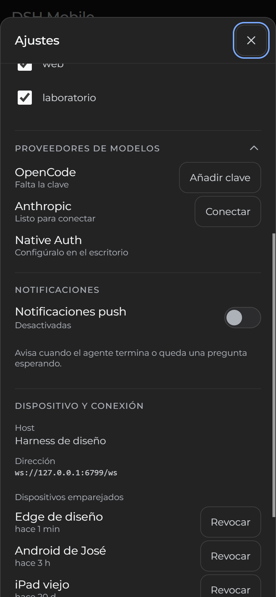
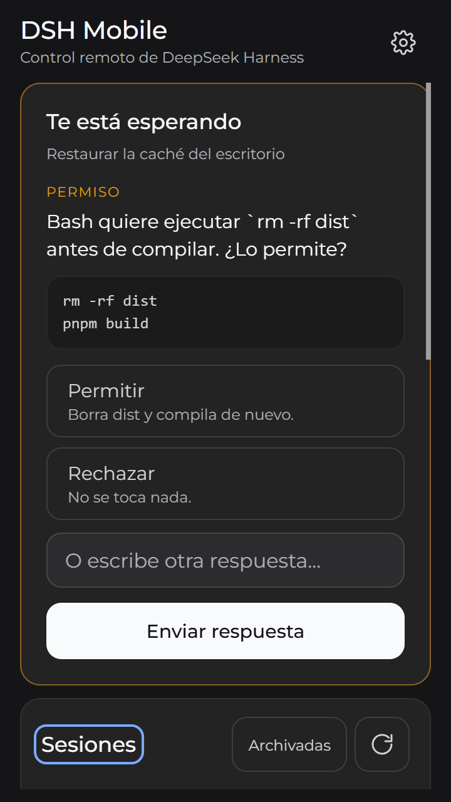

# Screenshots

Every screenshot comes from the demo host (`tools/preview/fake-host.mjs`): fake sessions, a fake
provider and fake devices. No real workspace, provider key or session title appears.

Captured at 390×844 (the list also at 360×640), 2× scale.

## 1. Pairing

The pairing screen. The QR link does this automatically; the code and the host are for when the
camera is not at hand.

## 2. Sessions

The folder list with the session state, the waiting-question dot and the model of each row.

## 3. Conversation, usage and a permission card

The transcript with the model selector and the **usage chips**: context used over the window
(`64.0k/131.1k · 49%`), the cache-hit ratio (`74%`) and the decode speed (`41.0 tok/s`). Below,
the activity strip and a permission card answered inline.

## 4. Agent activity

The goal, its round, the subagents and the tasks inside the panel. The panel floats over the
conversation; the transcript keeps its height.

## 5. Slash commands

The `/` palette from the composer. The result appears above the composer and does not enter the
model transcript.

## 6. Model providers

Settings → Model providers: the catalog, the credential state of each provider and the
add-key/connect actions. The key stays on the host.

## 7. Paired devices

The paired list with the last-seen time and revoke. "Forget this device" revokes on the host
before clearing the phone.

## 8. Notifications

The push switch with the blocked, unsupported, insecure and iOS states explained inline.

## 9. Narrow list

The session list at 360×640.

The set is regenerated with `tools/preview`; see the README's Development section.
