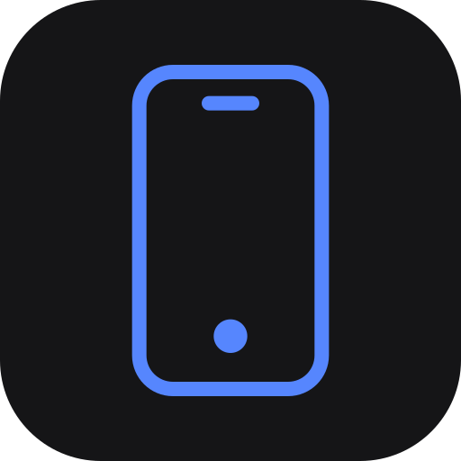
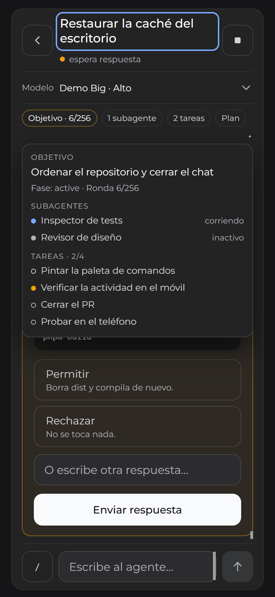
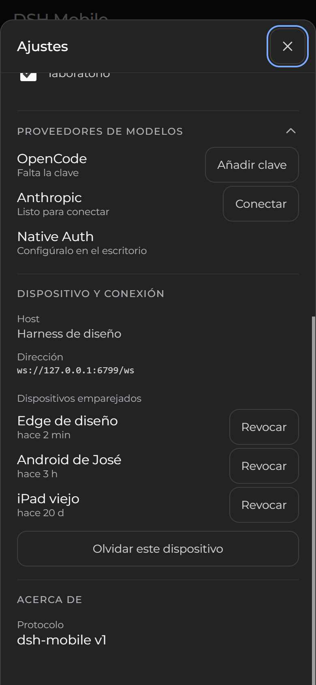

<div align="center">
  

  <h1>@deepseekharness-mobile/companion</h1>

  <p><strong>The host plugin for DSH Mobile.</strong><br />
  Serves the PWA, pairs phones and bridges the <code>dsh-mobile/1</code> contract to DeepSeek
  Harness — loopback-only, one token per device, no cloud in between.</p>

  <p>
    <a href="https://www.npmjs.com/package/@deepseekharness-mobile/companion"></a>
    <a href="https://www.npmjs.com/package/@deepseekharness-mobile/companion"></a>
    <a href="https://github.com/joseph12n/dsh-mobile/actions/workflows/ci.yml"></a>
    <a href="https://sonarcloud.io/summary/new_code?id=joseph12n_dsh-mobile"></a>
    <a href="https://github.com/joseph12n/dsh-mobile/blob/main/LICENSE"></a>
    <a href="https://github.com/deepseek-ai/deepseek-harness"></a>
    <a href="https://github.com/joseph12n/dsh-mobile/blob/main/docs/phone-setup.md"></a>
  </p>

  <p>
    
    
  </p>
</div>

## Install

```sh
dsh profile add @deepseekharness-mobile/companion
```

The profile reads the bundle's `cordis.patch.yml`, mounts the plugin and serves the embedded
PWA on `127.0.0.1:6768`. Restart DSH afterwards, run `/mobile` in a session and open the link
on the phone; the PWA installs from the browser menu.

The listener is **loopback-only** by design: the phone reaches it through the tailnet name with
`tailscale serve`, which provides HTTPS and a secure context. The full path, with the usual
problems, is in
[`docs/phone-setup.md`](https://github.com/joseph12n/dsh-mobile/blob/main/docs/phone-setup.md).

## What the phone gets

- **Live transcript** with paged history, separated reasoning and streaming events.
- **Questions and approvals**, including the blocking `ask_user_question`, in an inline card.
- **Agent activity**: goal and round, running subagents and open tasks in a floating panel that
  does not shrink the conversation.
- **Slash commands** from the composer, with the result outside the model transcript.
- **Model providers**: test a key and connect it; the key is stored on the host and never comes
  back, and endpoints, headers, model overrides and OAuth stay on the desktop.
- **Paired devices**: last seen, revoke and forget, with the host revoking first.
- **Sessions, folders, model choice**, write and cancel, and an installable PWA with four
  locales.

The full feature tour, the architecture and the security model live in the
[repository README](https://github.com/joseph12n/dsh-mobile#readme).

## Security

- **Loopback only.** The listen address is a constant, not an option; the tailnet name is the
  only supported path and LAN access is not implemented.
- **Pair before anything.** The QR carries a single-use code in the URL fragment, valid for
  10 minutes and never written to a log; redeeming it creates a device token stored as a hash.
- **One token per device.** Revoking one cuts its sockets and does not affect the others.
- **The host decides.** Capabilities are negotiated in `hello.ok`; the client cannot see or do
  what the server does not send.

## Documentation

- [Repository](https://github.com/joseph12n/dsh-mobile) — the product, the features and the
  screenshots.
- [Phone setup](https://github.com/joseph12n/dsh-mobile/blob/main/docs/phone-setup.md) —
  Tailscale, pairing and the usual problems.
- [Architecture](https://github.com/joseph12n/dsh-mobile/blob/main/docs/architecture.md) — why
  it is built this way.
- [`@deepseekharness-mobile/protocol`](https://www.npmjs.com/package/@deepseekharness-mobile/protocol)
  — the wire contract, also on npm.

## License

MIT
