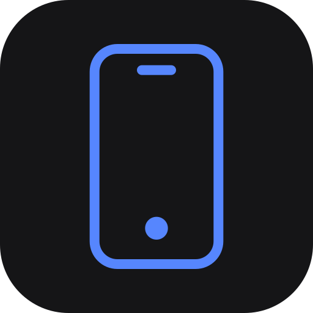

<div align="center">
  

  <h1>@deepseekharness-mobile/protocol</h1>

  <p><strong>The versioned wire contract for DSH Mobile.</strong><br />
  Zod schemas for the envelopes, messages, capabilities and pairing URL shared by the host
  plugin and the PWA.</p>

  <p>
    <a href="https://www.npmjs.com/package/@deepseekharness-mobile/protocol"></a>
    <a href="https://github.com/joseph12n/dsh-mobile/actions/workflows/ci.yml"></a>
    <a href="https://sonarcloud.io/summary/new_code?id=joseph12n_dsh-mobile"></a>
    <a href="https://github.com/joseph12n/dsh-mobile/blob/main/LICENSE"></a>
    <a href="https://github.com/joseph12n/dsh-mobile/blob/main/packages/protocol/package.json"></a>
    <a href="https://github.com/joseph12n/dsh-mobile/blob/main/packages/protocol/package.json"></a>
  </p>
</div>

## The contract

The phone never talks to DSH's internals. It talks **`dsh-mobile/1`**: a versioned protocol with
one Zod schema per frame, owned by this package and consumed by both ends.

- **One schema, two consumers.** An incompatible change breaks the build instead of the user.
- **Envelopes.** Every frame carries `v`, `id`, `at` and `type`; requests pair with `*.ok`
  responses and typed `error` frames.
- **Capabilities.** `hello.ok` lists what the host can do; the client gates its UI on that list.
- **Pairing.** `parsePairingUrl` and the 10-minute, single-use code format live here too.

## Install

```sh
pnpm add @deepseekharness-mobile/protocol
```

## Use

```ts
import { ClientMessage, PROTOCOL_VERSION, ServerMessage } from '@deepseekharness-mobile/protocol';

const frame = ClientMessage.safeParse(input);
if (!frame.success) throw new Error('not a dsh-mobile/1 frame');

const reply = ServerMessage.safeParse(output);
```

## Inside

| Module        | What it holds                                                  |
| ------------- | -------------------------------------------------------------- |
| `messages.ts` | The client and server message unions and the `error` codes     |
| `domain.ts`   | Sessions, transcripts, models, activity, providers and devices |
| `pairing.ts`  | The pairing URL and the code format                            |
| `version.ts`  | `PROTOCOL_VERSION` and the `dsh-mobile/1` constant             |

## Links

- [Repository](https://github.com/joseph12n/dsh-mobile) — the product and the host plugin.
- [`@deepseekharness-mobile/companion`](https://www.npmjs.com/package/@deepseekharness-mobile/companion)
  — the plugin that speaks this contract.
- [Architecture](https://github.com/joseph12n/dsh-mobile/blob/main/docs/architecture.md) — the
  layers and the decisions behind them.

## License

MIT
